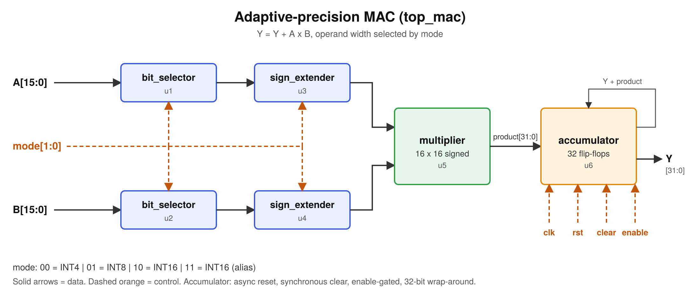
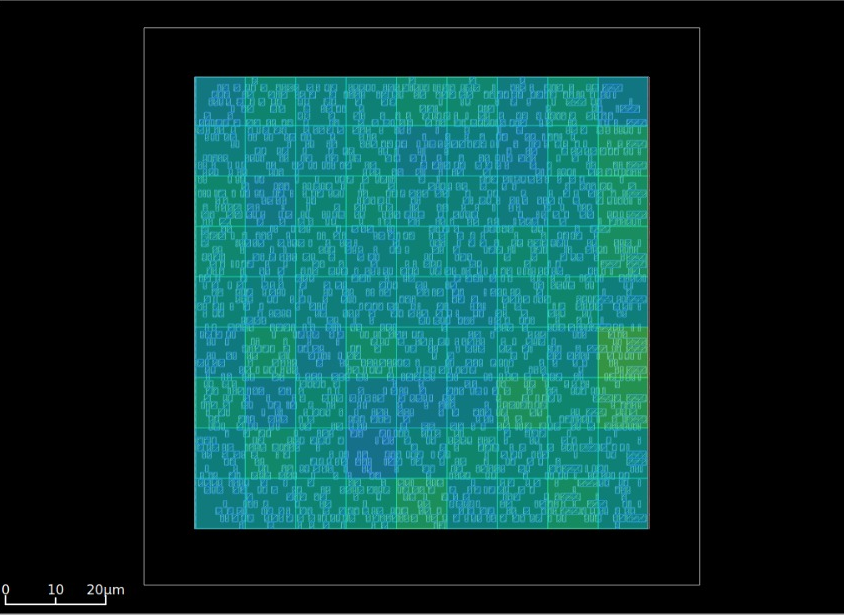

# Adaptive-precision MAC: open-source RTL to routed layout

A multiply-accumulate (MAC) unit with runtime-selectable operand precision (INT4 / INT8 / INT16), taken from RTL through verification, synthesis, timing, power analysis and place-and-route using only open-source tools.

MAC units are the basic building block of GPUs, TPUs and NPUs. Arranged in a grid (a systolic array), they perform the matrix multiplications that neural networks are built on. This repo is a single MAC, kept small enough to run the whole flow end to end.



## What it does

`Y = Y + A x B`, where the operands are 16-bit signed values and `mode` selects how many low bits of each operand are used (sign-extended to 16 bits before the multiply).

| mode | precision |
|------|-----------|
| `00` | INT4 |
| `01` | INT8 |
| `10` | INT16 |
| `11` | INT16 (alias) |

The accumulator is 32 bits with wrap-around, asynchronous active-high reset, synchronous clear (priority over enable) and an enable.

## Flow, tools and technology

| Step | Tool |
|------|------|
| Simulation | Icarus Verilog |
| Code coverage | Covered |
| Synthesis | Yosys |
| Static timing and power | OpenSTA |
| Place and route | OpenROAD |

Technology: Nangate 45 nm Open Cell Library (FreePDK45), typical corner. This is an academic PDK and is not manufacturable.

Versions used: Yosys 0.69+187, OpenSTA 3.1.0, Covered 20090802, Icarus Verilog [add output of `iverilog -V`], OpenROAD [add output of `openroad -version`].

The RTL is plain Verilog-2001 on purpose: Covered cannot parse `always_ff`, `always_comb` or `logic`.

## Results

| Stage | Result |
|-------|--------|
| Verification | 26,083 checks, 0 errors (self-checking testbench against a reference model) |
| Coverage (Covered) | 100% line, 100% toggle, 100% combinational |
| Synthesis (Yosys) | 2092 cells, 32 flip-flops, 2433.9 um^2 |
| Timing, post-synthesis (OpenSTA, 20 ns clock) | setup slack +14.02 ns, hold slack +0.11 ns |
| Timing, post-route (OpenROAD, 20 ns clock) | setup slack +13.947 ns, hold slack +0.114 ns |
| Clock tree | 5 buffers, skew about 0 |
| Routing | 0 antenna violations, 0 overflow, empty DRC report |
| Area (post-route) | 2494 um^2, 31% utilization |
| Power, OpenROAD (default activity) | 1.14 mW total: internal 0.563, switching 0.516, leakage 0.057 mW |
| Power, OpenSTA (50% input activity, post-synthesis, ideal clock) | 4.89 mW total: internal 2.67, switching 2.16, leakage 0.056 mW |

The two power numbers differ because they assume different switching activity. They are estimates, not measurements, and should only be compared with runs made with the same settings. In the OpenSTA run, 98.6% of the power is in combinational logic (mainly the multiplier) and 1.4% in the flip-flops.



Reports: [`timing-power_reports/`](timing-power_reports/) (OpenSTA), [`results/`](results/) (Yosys, Covered, OpenROAD).

Test coverage: directed corner values in all four modes, enable held low, clear priority over enable, 32-bit wrap-around, asynchronous reset in the middle of a run, and 20,000 constrained-random cycles.

## Reproduce

Prerequisites: `iverilog`, `covered`, `yosys`, `sta` (OpenSTA) and an OpenROAD build with its `test/` folder. Run everything from the repo root.

Get `NangateOpenCellLibrary_typical.lib` (in the OpenROAD / OpenROAD-flow-scripts repos under `platforms/nangate45/lib`) and put it in the repo root. It is not committed.

```bash
mkdir -p build

# 1. simulate (prints TEST PASSED)
iverilog -o adaptive_mac top_mac.v accumulator.v multiplier.v bit_selector.v sign_extender.v tb_top_mac.v
vvp adaptive_mac

# 2. coverage
sed -i '/^\$comment/d' build/top_mac.vcd
covered score -t top_mac -i tb_top_mac.uut \
  -v top_mac.v -v accumulator.v -v multiplier.v -v bit_selector.v -v sign_extender.v \
  -vcd build/top_mac.vcd -o build/top_mac.cdd
covered report -m ltc -d s build/top_mac.cdd

# 3. synthesis
yosys -s synth_commands.tcl
sed -i 's/ signed / /' build/top_mac_netlist.v

# 4. timing and power
sta -no_init -exit sta_top_mac.tcl
sta -no_init -exit power_top_mac.tcl
```

Place and route: copy `build/top_mac_netlist.v` to a work folder as `top_mac_nangate45.v`, link `flow.tcl`, `helpers.tcl`, `flow_helpers.tcl` and `Nangate45/` from the `test/` folder of your OpenROAD checkout, add the two files in [`openroad/`](openroad/), and run `openroad -no_init -exit top_mac_nangate45.tcl`.

Notes:
- The `sed` after synthesis removes the `signed` keyword from the netlist ports. Newer Yosys writes it, and OpenSTA and OpenROAD cannot parse it. It does not change behavior, because synthesis has already turned the arithmetic into gates.
- The clock period is 20 ns in every script. Use the same period if you compare runs.

## Known limitations

- The multiplier is a fixed 16x16, so INT4 and INT8 modes do not reduce area or power yet. The adaptive precision currently changes the numeric result, not the hardware cost.
- The 20 ns clock is very relaxed. The logic path is only about 2 ns, so the slack numbers say little about the design's real speed.
- Power figures are activity-based estimates, not derived from simulation switching.
- DRC is judged by the empty report file. The violation count is not printed because the flow runs routing with reduced verbosity.
- The flow ends at the routed layout. GDS export has not been done.

## Next steps

- Operand isolation so unused multiplier bits stop toggling in INT4 and INT8 modes, then compare area, timing and power against this baseline.
- Tighten the clock to a realistic target and rerun the baseline.
- Gate-level simulation and VCD-based power.
- GDS export.

Feedback and suggestions are welcome. Please open an issue.

## License

MIT, see [LICENSE](LICENSE).
